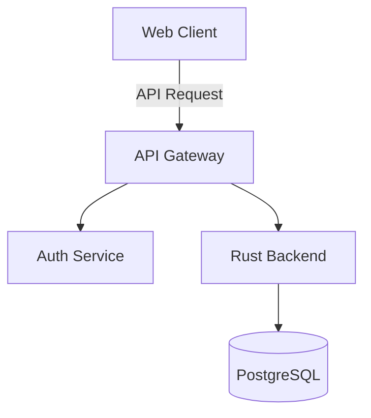
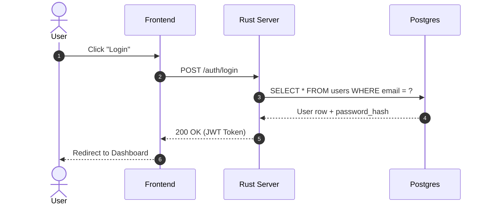
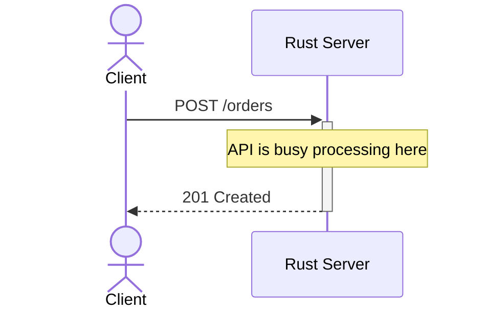
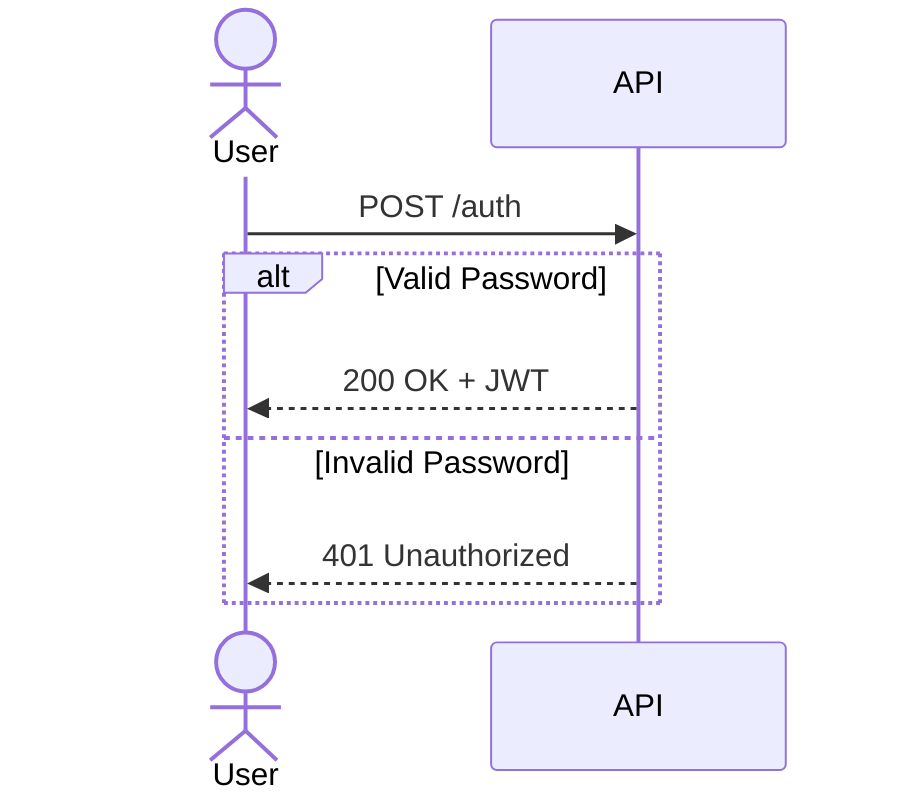
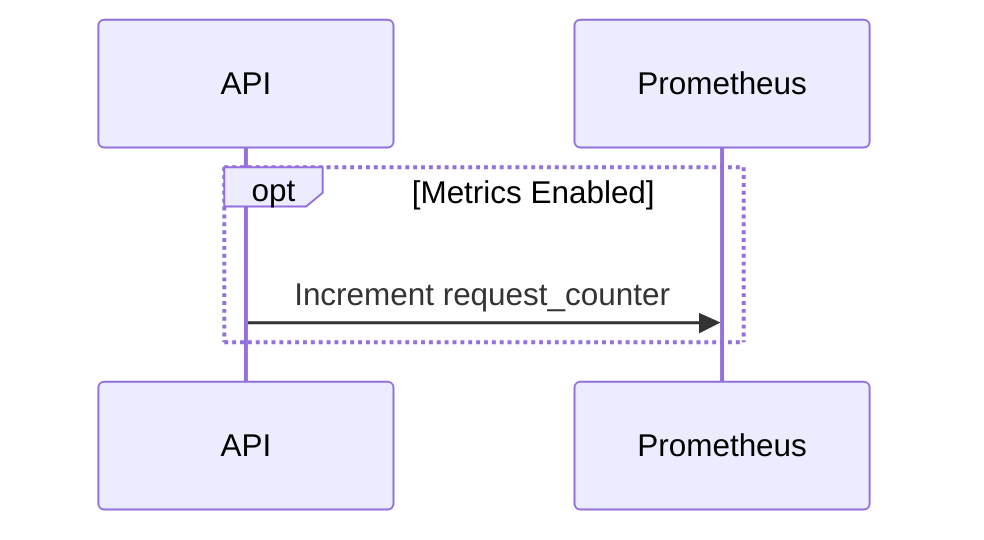

# 💤 LazyVim


A starter template for [LazyVim](https://github.com/LazyVim/LazyVim).
Refer to the [documentation](https://lazyvim.github.io/installation) to get started


# Architecture Flow



```d2
direction: right
frontend: Web App
backend: Axum Server
db: Postgres

frontend -> backend: REST API
backend -> db: SQL Queries
```









```



