Here is a complete, reference-grade guide covering **all syntax features** supported in Mermaid.js Sequence Diagrams, categorized logically with clear code examples.

---

### 1. Diagram Declaration, Titles & Comments

Every sequence diagram starts with `sequenceDiagram`. You can add YAML frontmatter for metadata/titles and `%%` for comments.

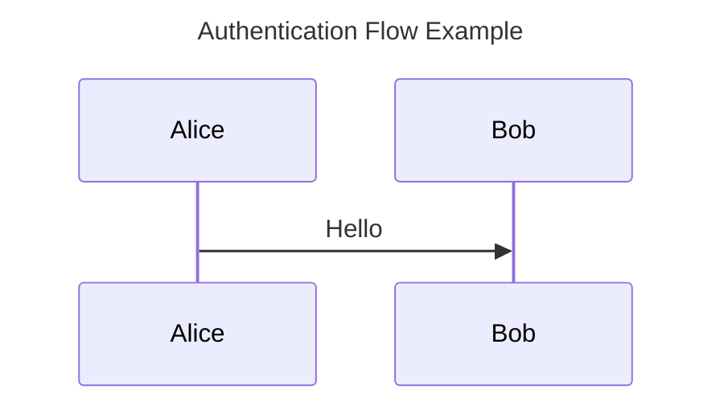

* **`sequenceDiagram`**: Initializes the sequence diagram renderer.
* **`title`**: Defines a diagram title (via frontmatter).
* **`%% Comment text`**: A comment on its own line (ignored during rendering).
* **Accessibility Titles/Descriptions**:
  ```mermaid
  sequenceDiagram
      accTitle: User Login
      accDescr: Sequence diagram demonstrating token exchange
      Alice->>Bob: Hello
  ```

---

### 2. Participants & Actors (Shapes, Stereotypes & Aliases)

Participants are drawn left-to-right in the order they appear or are explicitly declared.

#### A. Standard Participant vs. Actor
* `participant`: Renders as a rectangular box.
* `actor`: Renders as a stick-figure humanoid icon.

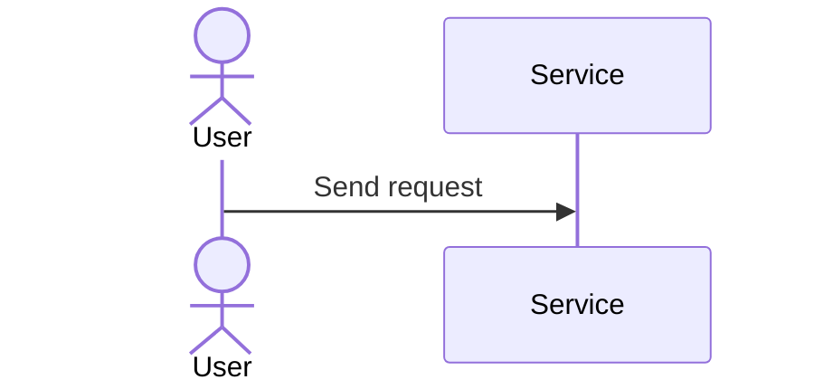

#### B. UML Stereotype Shapes (Participant Types)
Mermaid supports specialized UML participant types defined via JSON metadata (`@{ "type": "..." }`):
* `boundary`: External interface/boundary symbol
* `control`: Controller circle with arrow
* `entity`: Entity circle with underline
* `database`: Cylinder shape
* `collections`: Stacked rectangles
* `queue`: Queue symbol

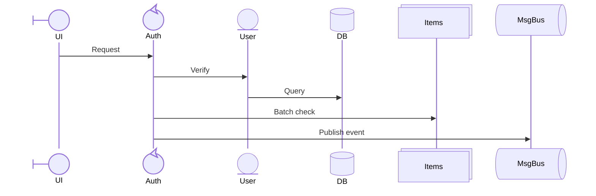

#### C. Aliases
Assign shorter variable IDs to participants using either external or inline syntax.

* **External syntax (`as`)**:
  ```mermaid
  sequenceDiagram
      participant A as System Gateway API
      actor U as Registered User
      U->>A: Call API
  ```

* **Inline syntax with types**:
  ```mermaid
  sequenceDiagram
      participant DB@{ "type": "database", "alias": "Customer Database" }
      participant API@{ "type": "boundary" } as Public API
      API->>DB: Read records
  ```
  *(Note: If both are specified, the external `as` alias takes precedence).*

---

### 3. Dynamic Lifecycle (Create & Destroy)

Dynamically show the spawning or termination of an actor during runtime.

* **`create participant <Name>`**: Placed immediately prior to a message directed to that actor.
* **`destroy <Name>`**: Marks the actor as terminated with an `X` on its lifeline.

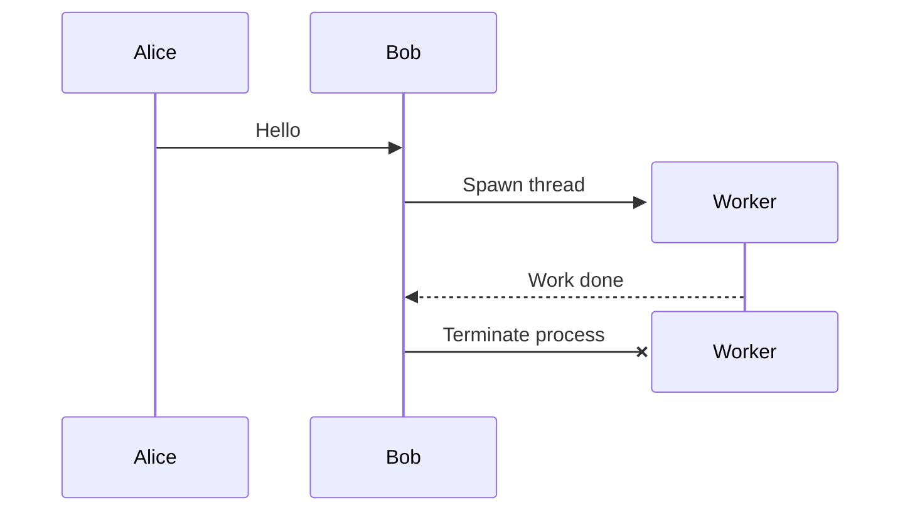

---

### 4. Boxes (Grouping Participants)

Visually bundle lifelines inside colored vertical background columns.

* **Syntax**: `box [color] [Title] ... end`
* Supported color formats: Named color (`Purple`, `LightBlue`), `rgb(...)`, `rgba(...)`, `hsl(...)`, `hsla(...)`, or `transparent`. *(Hex codes like `#fff` are not supported directly here).*

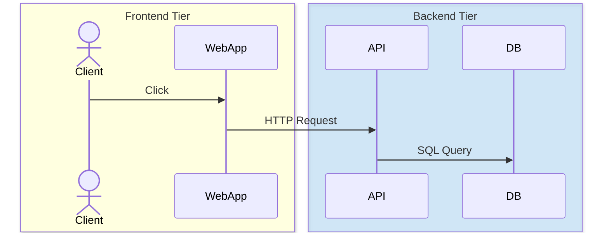

---

### 5. Messages & Arrow Types

Messages follow the structure:
`[Sender][Arrow][Receiver]: [Message text]`

#### A. Standard Arrowhead Variations

| Arrow | Line Style | Arrowhead Type | Typical Meaning |
| :--- | :--- | :--- | :--- |
| `->` | Solid | None | Simple line |
| `-->` | Dotted | None | Simple return line |
| `->>` | Solid | Filled arrow | Synchronous call |
| `-->>` | Dotted | Filled arrow | Return value / Response |
| `-x` | Solid | Cross `X` | Blocked / Lost message |
| `--x` | Dotted | Cross `X` | Lost / Failed response |
| `-)` | Solid | Open arrow | Asynchronous message |
| `--)` | Dotted | Open arrow | Async reply |
| `<<->>` | Solid | Bidirectional filled | Two-way handshake |
| `<<-->>` | Dotted | Bidirectional filled | Dotted two-way sync |

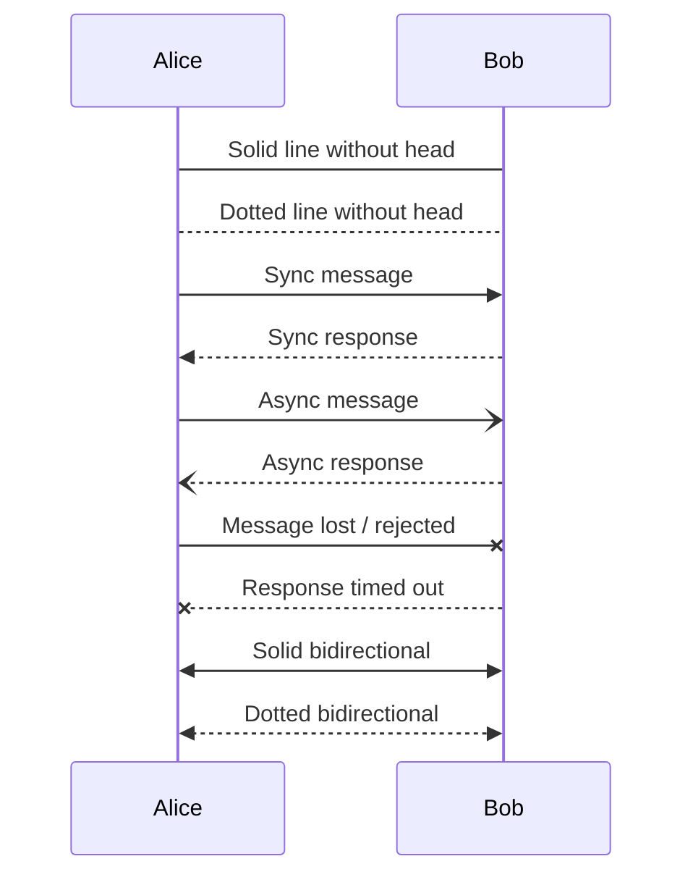

#### B. Half-Arrows
Used for specialized UML notations. They come in both solid (`-`) and dotted (`--`) forms:

* **Top half filled**: `-|\` and `--|\`
* **Bottom half filled**: `-|/` and `--|/`
* **Reverse top half filled**: `/|-` and `/|--`
* **Reverse bottom half filled**: `\\-` and `\\--`
* **Top stick (open)**: `-\\` and `--\\`
* **Bottom stick (open)**: `-//` and `--//`
* **Reverse top stick (open)**: `//-` and `//--`

```mermaid
sequenceDiagram
    Alice-|\\Bob: Top half filled solid
    Alice--|\\Bob: Top half filled dotted
    Alice-|/Bob: Bottom half filled solid
    Alice--|/Bob: Bottom half filled dotted
    Alice-\\Bob: Stick top half solid
    Alice--//Bob: Stick bottom half dotted
```

#### C. Central Connections
Add `()` to an arrow to attach the message endpoint directly to a central lifeline point rather than another actor.

* `Alice->>()Bob`: Connects to central point before reaching Bob
* `Alice()->>Bob`: Connects from central point from Alice
* `Alice()->>()Bob`: Dual central lifeline connection

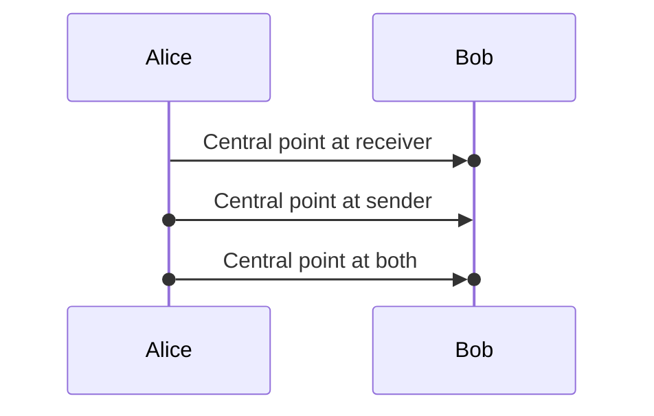

---

### 6. Lifeline Activations & Deactivations

Activations draw vertical bars representing processing periods on lifelines.

#### Method 1: Explicit Directives
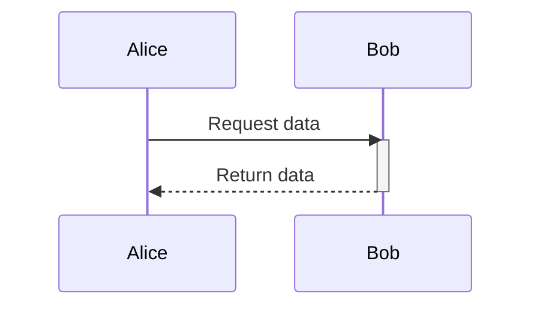

#### Method 2: Arrow Shorthand (`+` and `-`)
Append `+` to the receiver to activate it, and `-` to the sender to deactivate it.

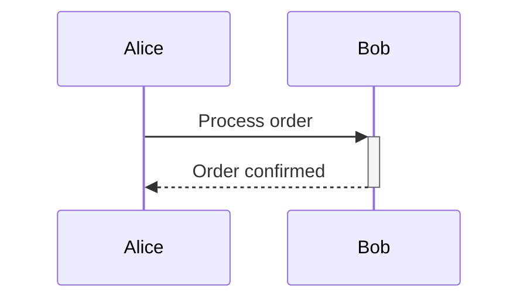

#### Method 3: Nested / Stacked Activations
Stack multiple calls on the same lifeline by activating multiple times before deactivating.

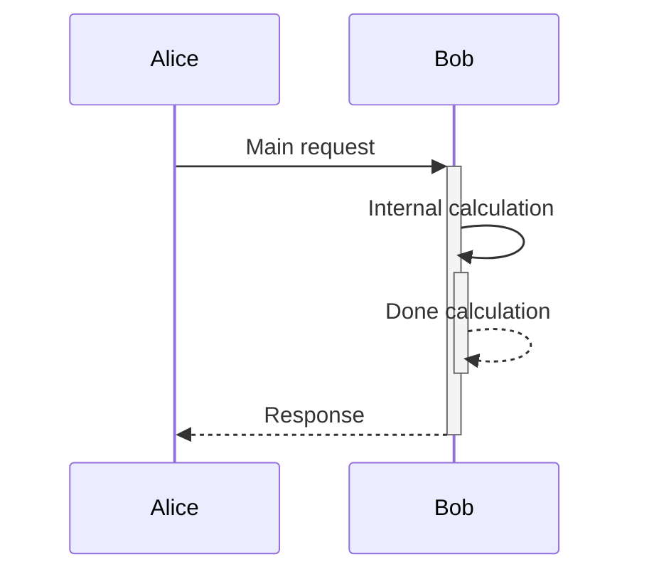

---

### 7. Notes

Add contextual callouts positioned over or beside lifelines.

* **Positioning**:
  * `Note left of <Actor>: Text`
  * `Note right of <Actor>: Text`
  * `Note over <Actor>: Text`
  * `Note over <ActorA>,<ActorB>: Text` (spans multiple participants)

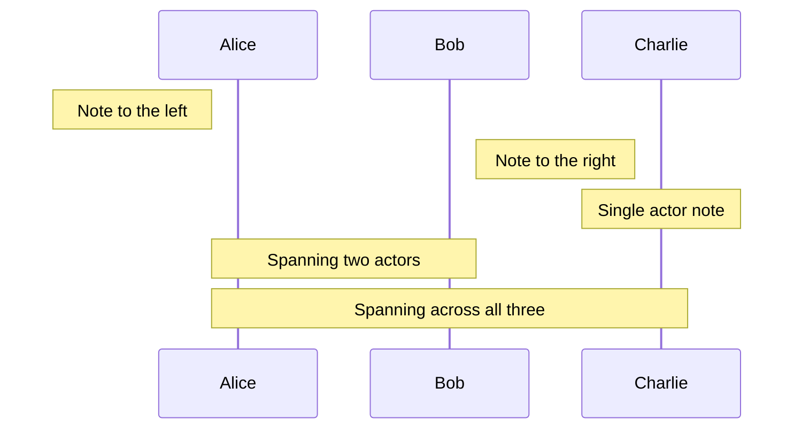

---

### 8. Control Flow & Fragments

Control blocks group interactions according to runtime conditions or logic.

#### A. Loops (`loop ... end`)
Represents repetitive actions.
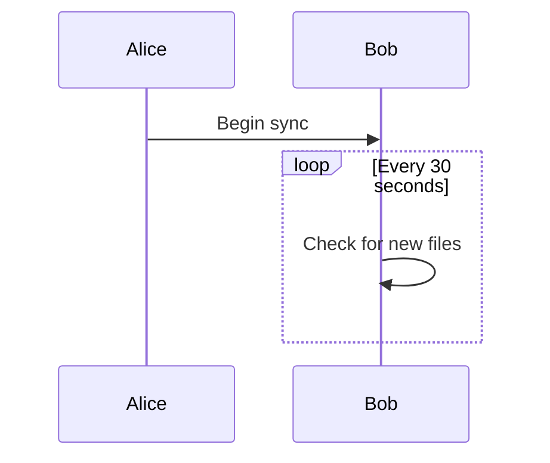

#### B. Conditional Paths (`alt ... else ... end`)
Represents an `if / else` alternative execution.
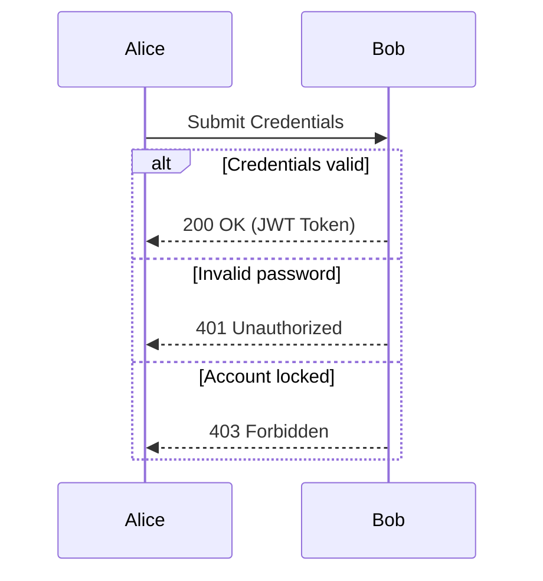

#### C. Optional Paths (`opt ... end`)
Represents an optional sequence executed only when a condition is met (an `if` without an `else`).
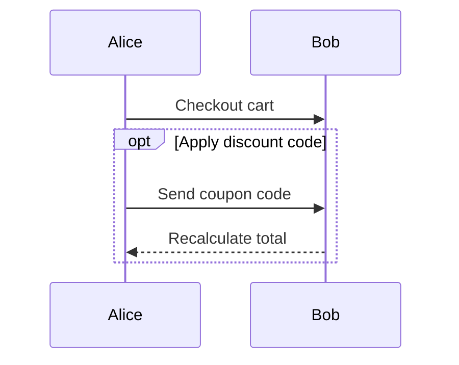

#### D. Parallel Execution (`par ... and ... end`)
Represents concurrent execution across threads or services. Can be nested.
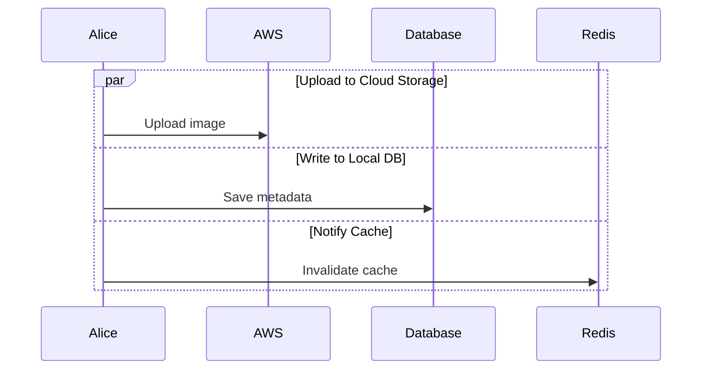

#### E. Critical Region (`critical ... option ... end`)
Represents critical sections that must execute atomically, with fallback exception handlers.
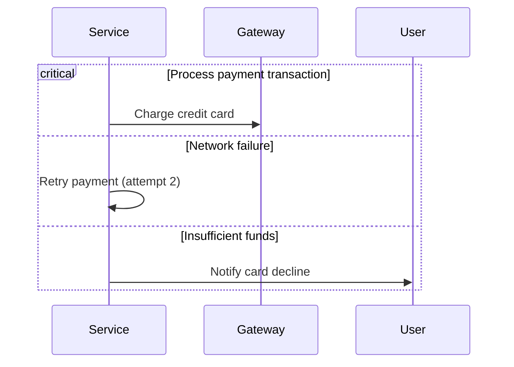

#### F. Flow Break (`break ... end`)
Represents stopping the sequence early, typically due to an exception or early exit.
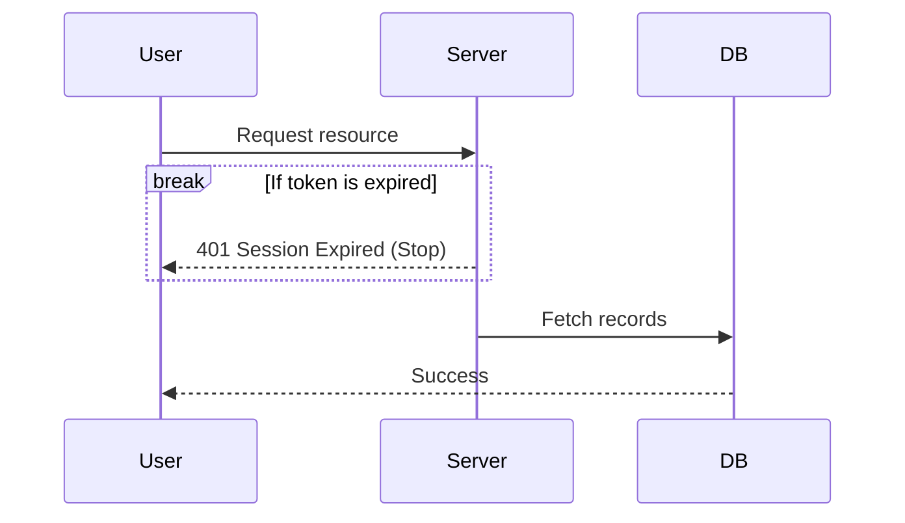

---

### 9. Background Highlighting (`rect`)

Highlights an area of the diagram with a background color using RGB or RGBA notation. Blocks can be nested.

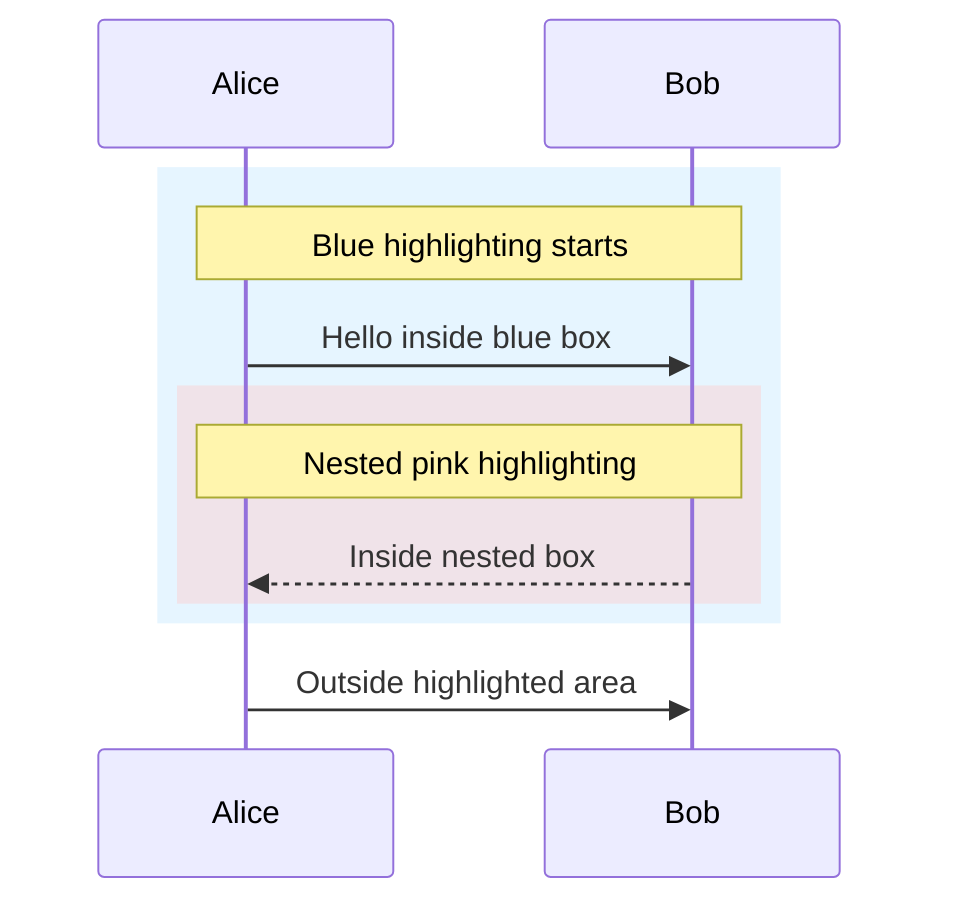

---

### 10. Automatic Sequence Numbering (`autonumber`)

Automatically attaches incremental numbers to all message arrows.

* **Standard**: Starts at 1, increments by 1.
  ```mermaid
  sequenceDiagram
      autonumber
      Alice->>Bob: First step (1)
      Bob-->>Alice: Second step (2)
  ```

* **Custom Start and Increment**: `autonumber <start> <increment>`
  ```mermaid
  sequenceDiagram
      autonumber 10 5
      Alice->>Bob: Numbered 10
      Bob->>Charlie: Numbered 15
      Charlie-->>Alice: Numbered 20
  ```
  *(Decimal increments such as `autonumber 1.5 0.5` are also supported).*

---

### 11. Actor Menus & Interactive Links

Make participants clickable with dropdown menus or external links.

* **Single Link Format**: `link <Actor>: <Label> @ <URL>`
  ```mermaid
  sequenceDiagram
      participant API
      link API: Health Check @ https://status.example.com
      link API: Swagger Docs @ https://api.example.com/docs
      Alice->>API: GET /users
  ```

* **JSON Multiple Links Format**: `links <Actor>: {"Label": "URL", ...}`
  ```mermaid
  sequenceDiagram
      participant Worker
      links Worker: {"Dashboard": "https://dashboard.example.com", "Logs": "https://logs.example.com"}
      Alice->>Worker: Dispatch task
  ```

---

### 12. Escaping, Line Breaks & Special Characters

* **Line Breaks**: Insert `<br/>` into message text, notes, or actor aliases:
  ```mermaid
  sequenceDiagram
      participant A as Service<br/>Node A
      A->>A: First line<br/>Second line
      Note over A: Multi-line<br/>note content
  ```
* **HTML Character Entities & Numeric Codes**:
  Use HTML codes (e.g., `#9829;` for ♥, `#59;` for semicolons, `#35;` for hash, `#infin;` for ∞).
  ```mermaid
  sequenceDiagram
      Alice->>Bob: I #9829; Mermaid #35;1!
      Bob-->>Alice: Wait #59; are you sure?
  ```
* **Handling Reserved Word `"end"`**:
  Because `end` closes blocks, wrap literal words in quotes, parentheses, or brackets:
  ```mermaid
  sequenceDiagram
      Alice->>Bob: Reached "end" of transmission
  ```

---

### 13. Advanced Directives & In-Diagram Configuration

Configurations can be injected using YAML frontmatter or `%%{init: ...}%%` directives.

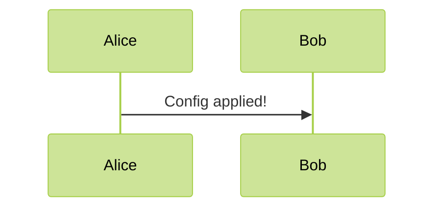

Key Sequence Diagram config flags:
* `mirrorActors`: `true` / `false` (repeats the actor headers at the bottom of the diagram)
* `showSequenceNumbers`: `true` / `false`
* `wrap`: `true` / `false` (auto-wraps long message texts)
* `rightAngles`: `true` / `false` (sharp vs rounded corners)
* `noteAlign`: `'left'`, `'center'`, or `'right'`

---

### 14. Comprehensive Master Example

Here is a single diagram integrating participants with types, aliases, boxes, autonumbering, stacked activations, notes, control blocks, and arrow types:

```mermaid
---
title: Complete Order Processing Sequence
config:
  theme: default
---
sequenceDiagram
    autonumber 100 10

    box LightBlue Client Application
        actor Customer
        participant UI@{ "type": "boundary", "alias": "Web Frontend" }
    end

    box Lavender Core Infrastructure
        participant API@{ "type": "control", "alias": "API Gateway" }
        participant Worker
        participant DB@{ "type": "database", "alias": "PostgreSQL" }
    end

    Customer->>+UI: Click "Buy Now"
    UI->>+API: POST /orders
    Note over UI,API: HTTPS Request with Bearer Token

    API->>+DB: Check stock
    DB-->>-API: Items in stock

    alt Stock Available
        create participant Worker
        API->>Worker: Spawn background payment worker
        Worker-)API: Async processing started

        critical Secure Payment
            Worker->>Worker: Contact Payment Provider
        option Connection Timeout
            Worker->>Worker: Retry with exponential backoff
        end

        destroy Worker
        Worker-xAPI: Task finished & terminated
        API-->>UI: 201 Created (Order ID)
    else Out of Stock
        break Insufficient Inventory
            API-->>UI: 409 Conflict
            UI-->>Customer: Display "Sold Out"
        end
    end

    UI-->>-Customer: Show order confirmation page
    deactivate API
```
